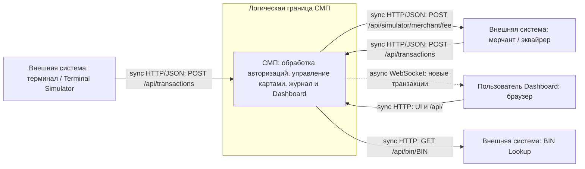

# А1. C4 Level 1 — Context

## Чего не хватало и что добавлено

В исходном проекте нет отдельной Context-диаграммы. Добавлены логическая граница ядра СМП, внешние участники и протокол каждой связи. Это C4-представление в нотации Mermaid: PostgreSQL, RabbitMQ и внутренние компоненты скрыты на этом уровне.

## Границы и контракты

- Терминал и мерчант отправляют JSON по HTTP, **не** ISO 8583 по TCP. `mti`, `stan`, `pan` — поля HTTP DTO; наличие `mti` само по себе не означает другой транспорт. Ответ идёт в том же HTTP-обмене.
- Внешний BIN Lookup логически является зависимостью Authorization. Для локальной среды его роль выполняет контейнер `bin-lookup` со статической таблицей и параметрами `delay`/`fail`. Ошибка lookup возвращает `Optional.empty()`; `AuthServiceImpl` только логирует результат, не подменяет им issuerId запроса.
- Браузер получает Dashboard и HTTP API через nginx Dashboard; `/api/` проксируется в Gateway, `/ws/` — напрямую в Logger. WebSocket здесь не RabbitMQ и не синхронный HTTP-запрос с результатом авторизации.
- На Context-уровне терминал, мерчант и BIN показаны снаружи **логической** границы. На А2 они также показаны как реальные локальные контейнеры-симуляторы внутри Docker deployment; это другая граница, не противоречие.
- Уведомления в этой реализации сохраняет Notification Service. Внешние SMS/email-провайдеры в карту не добавлены: просмотренный код не подтверждает такие вызовы.

## Подтверждение кодом

- [Terminal GatewayClient](../../../services/terminal-simulator/src/main/java/com/processing/terminalsimulator/client/GatewayClient.java): `sendToGateway`, получение карт напрямую из CMS.
- [Merchant GatewayClient](../../../services/merchant-acquirer/src/main/java/com/processing/merchantacquirer/client/GatewayClient.java): `processAuthorize`, `getCards`.
- [MerchantAcquirerClient](../../../services/switch/src/main/java/com/processing/service/MerchantAcquirerClient.java): исходящий HTTP-запрос комиссии.
- [Dashboard nginx.conf](../../../services/dashboard/nginx.conf), [useWebSocket](../../../services/dashboard/src/hooks/useWebSocket.ts), [useStats](../../../services/dashboard/src/hooks/useStats.ts).
- [BinLookupClient](../../../services/authorization/src/main/java/com/processing/authorization/client/BinLookupClient.java), [BinLookupController](../../../services/bin-lookup/src/main/java/com/processing/binlookup/controller/BinLookupController.java), [AuthServiceImpl](../../../services/authorization/src/main/java/com/processing/authorization/services/AuthServiceImpl.java).
- [CardEventListener](../../../services/notification-service/src/main/java/com/processing/notification/listener/CardEventListener.java), [docker-compose.yaml](../../../docker-compose.yaml).
