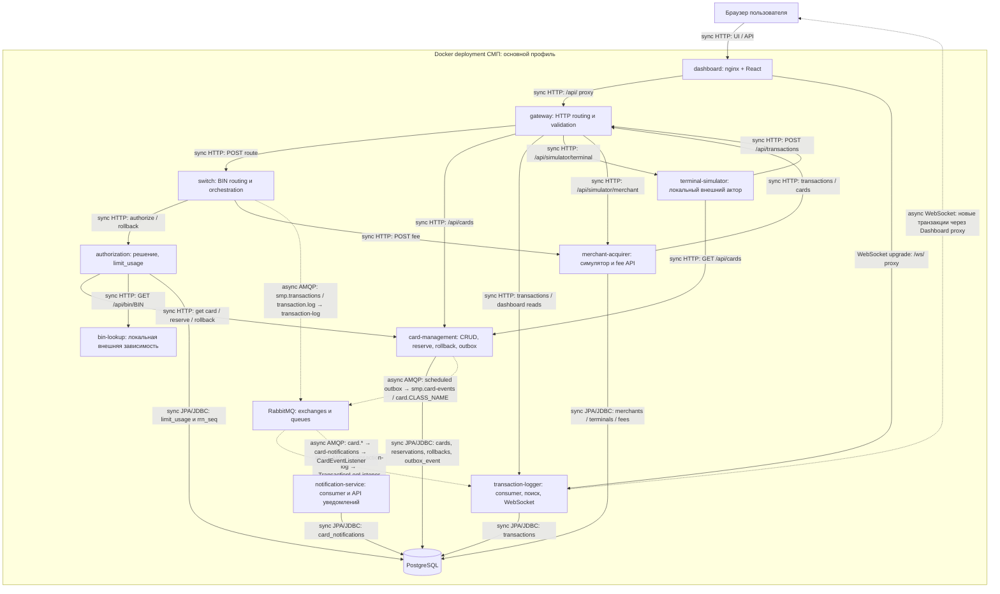

# А2. C4 Level 2 — Container

## Чего не хватало и что добавлено

Исходная Container-карта не различает sync/async и не показывает outbox и ограничения confirms. Добавлены протоколы, две AMQP-ветви, хранилища и сверка с Compose.

**Расхождение задания с кодом:** в `docker-compose.yaml` определены **10 прикладных контейнеров**, PostgreSQL и RabbitMQ, а не 11 прикладных сервисов. `common` — библиотека; `e2e-tests` — Maven-модуль тестов, не отдельный Compose-сервис. Одиннадцатый прикладной сервис не выдуман. Пять дополнительных контейнеров профиля `observability` перечислены отдельно.

Сплошные линии подписаны как sync HTTP/JDBC, кроме явно подписанного WebSocket upgrade. Пунктир — async AMQP или push WebSocket. Обратные HTTP-ответы подразумеваются. Локальные вызовы внутри контейнера раскрыты в А3; DLX/DLQ — в А5. Health/metrics-запросы не смешаны с бизнес-потоком.

## Сверка deployment

| Compose-сервис | Роль и вход | Зависимости, подтверждённые реализацией |
|---|---|---|
| gateway | HTTP, внутренний порт 8080 | Switch, CMS, Logger, Terminal, Merchant; health также Authorization |
| switch | HTTP 8080 | Authorization, Merchant fee API, RabbitMQ; logger URL есть в настройках, но `LoggerClient` использует AMQP |
| authorization | HTTP 8080 при SERVER_PORT из Compose | CMS, BIN Lookup, PostgreSQL |
| card-management | HTTP 8080 | PostgreSQL, RabbitMQ, outbox scheduler |
| transaction-logger | HTTP/WebSocket 8080, AMQP consumer | PostgreSQL, RabbitMQ |
| notification-service | HTTP 8080, AMQP consumer | PostgreSQL, RabbitMQ; `/api/notifications` доступен напрямую, отдельного Gateway-маршрута нет |
| bin-lookup | HTTP 8080 | Статическая таблица; нет JDBC/AMQP в controller |
| terminal-simulator | HTTP 8080 | Gateway для транзакций, CMS напрямую для карт |
| merchant-acquirer | HTTP 8080 | Gateway, PostgreSQL |
| dashboard | HTTP/WebSocket proxy 3000 | nginx → Gateway и Logger; React выполняется в браузере |
| postgres | TCP 5432 | Один локальный экземпляр, таблицы нескольких сервисов |
| rabbitmq | AMQP 5672, management 15672 | Два topic exchange, DLX/DLQ; А5 |

Внешние host-порты берутся из `.env`/Compose и не равны обязательно 8080. `depends_on` описывает запуск, **не** перечень всех рабочих вызовов. Контейнеры `prometheus`, `grafana`, `loki`, `promtail`, `autoscaler` включаются профилем `observability`; они не добавлены к числу прикладных сервисов. Их назначения и подключения задаются Compose и `infra/`.

## Async-границы и пробелы

- Switch возвращает ответ независимо от завершения Logger consumer. Включён correlated confirm, но нет ожидания ack в течение 2s. Ошибка `convertAndSend` запускает HTTP rollback только для исходного APPROVED.
- CMS сначала сохраняет outbox через `CardEventNotifierImpl`; scheduler публикует отдельным шагом. Нельзя отождествлять HTTP 200, PROCESSED outbox и сохранение Notification.
- При reserve/rollback/patch/delete локальные изменения и событие проходят через `TransactionRunner`. У `createCard` нет такой внешней обёртки: атомарность создания карты и outbox не доказана и требует отдельной проверки.
- RabbitMQ и PostgreSQL — два разных контура отказа; ни А2, ни локальная JPA-транзакция не обещают distributed exactly-once.

## Подтверждение кодом

- [docker-compose.yaml](../../../docker-compose.yaml), [Maven-модули](../../../services/pom.xml), [Dashboard nginx](../../../services/dashboard/nginx.conf).
- [Gateway routes](../../../services/gateway/src/main/resources/application.yml), [RouteService](../../../services/switch/src/main/java/com/processing/service/RouteService.java), [LoggerClient](../../../services/switch/src/main/java/com/processing/service/LoggerClient.java), [MerchantAcquirerClient](../../../services/switch/src/main/java/com/processing/service/MerchantAcquirerClient.java).
- [AuthServiceImpl](../../../services/authorization/src/main/java/com/processing/authorization/services/AuthServiceImpl.java), [Authorization datasource](../../../services/authorization/src/main/resources/application.yaml), [BinLookupClient](../../../services/authorization/src/main/java/com/processing/authorization/client/BinLookupClient.java).
- [CardServiceImpl](../../../services/card-management/src/main/java/com/processing/cardmanagement/services/CardServiceImpl.java), [CardEventNotifierImpl](../../../services/card-management/src/main/java/com/processing/cardmanagement/events/CardEventNotifierImpl.java), [OutboxProcessor](../../../services/card-management/src/main/java/com/processing/cardmanagement/services/OutboxProcessor.java), [CMS properties](../../../services/card-management/src/main/resources/application.properties).
- [TransactionLogListener](../../../services/transaction-logger/src/main/java/com/processing/transactionlogger/listener/TransactionLogListener.java), [TransactionService](../../../services/transaction-logger/src/main/java/com/processing/transactionlogger/service/TransactionService.java), [CardEventListener](../../../services/notification-service/src/main/java/com/processing/notification/listener/CardEventListener.java).
- [Terminal GatewayClient](../../../services/terminal-simulator/src/main/java/com/processing/terminalsimulator/client/GatewayClient.java), [Merchant GatewayClient](../../../services/merchant-acquirer/src/main/java/com/processing/merchantacquirer/client/GatewayClient.java), [Merchant datasource](../../../services/merchant-acquirer/src/main/resources/application.yaml).
