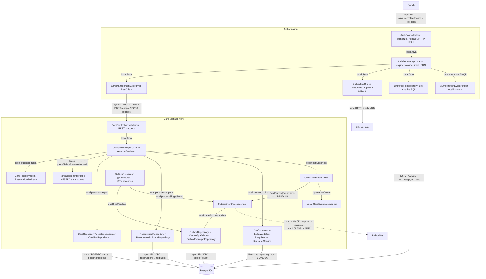

# А3. C4 Level 3 — Authorization и Card-Management

## Чего не хватало и что добавлено

Component-уровня в исходной карте нет. Добавлены controller → service → client/repository, локальные модели, транзакционные границы и отдельный outbox publisher. Обе области приведены в одном файле — всего сдаётся шесть файлов диаграмм.

## Разделение ответственности

- `AuthControllerImpl` определяет HTTP-статус ответа отдельно от `responseCode`. Например, BLOCKED — HTTP 403 и `CARD_BLOCKED`/`05`, а не всегда HTTP 200. Switch HTTP-клиент читает тело и у не-2xx бизнес-ответов.
- `AuthServiceImpl.authorize` в текущем коде проверяет статус → срок относительно UTC-даты `transmissionDateTime` → баланс → SQL-лимиты → резерв. Это отличается от порядка в старом test-design. `generateRRN` обращается к БД за блоком, поэтому это не полностью чистая функция.
- `CardManagementClientImpl` преобразует HTTP-коды CMS в доменные исключения. Его нельзя проверять только мокированием собственного интерфейса: контракт и десериализация требуют HTTP stub.
- `Card` содержит чистую арифметику баланса и проверку ACTIVE; `Reservation` — переход RESERVED → ROLLED_BACK. Здесь подходят unit-тесты без Spring/БД.
- `CardJpaRepository` использует `PESSIMISTIC_WRITE`; `CardEntity` скрывает DELETED через `@SQLRestriction`. SQL, изоляцию, фильтрацию и уникальность нельзя доказать моками репозитория.
- `CardEventNotifierImpl` направляет `CardOutboxEvent` в outbox, остальные события — локальным слушателям. Не каждый `notify` является сетевой публикацией.
- `OutboxProcessor` раз в `app.outbox.interval-ms` выбирает pending; `OutboxEventProcessorImpl` вызывает `convertAndSend`, сохраняет PROCESSED либо увеличивает retry и ставит FAILED при исчерпании. По умолчанию интервал 1000 ms, max retry 3; это настраиваемые значения.
- Наличие correlated confirms в properties не означает, что OP ждёт ack: такого ожидания нет. Для create нет общей сервисной транзакции вокруг сохранения карты и outbox; это зафиксировано как риск, а не исправлено в рамках документационной практики.

## Подтверждение кодом

- [AuthControllerImpl](../../../services/authorization/src/main/java/com/processing/authorization/controller/AuthControllerImpl.java), [AuthServiceImpl](../../../services/authorization/src/main/java/com/processing/authorization/services/AuthServiceImpl.java), [DeclineOutcome](../../../services/authorization/src/main/java/com/processing/authorization/constants/DeclineOutcome.java).
- [CardManagementClientImpl](../../../services/authorization/src/main/java/com/processing/authorization/client/CardManagementClientImpl.java), [BinLookupClient](../../../services/authorization/src/main/java/com/processing/authorization/client/BinLookupClient.java), [LimitUsageRepository](../../../services/authorization/src/main/java/com/processing/authorization/repositories/LimitUsageRepository.java).
- [CardController](../../../services/card-management/src/main/java/com/processing/cardmanagement/controllers/CardController.java), [CardServiceImpl](../../../services/card-management/src/main/java/com/processing/cardmanagement/services/CardServiceImpl.java), [AppConfig](../../../services/card-management/src/main/java/com/processing/cardmanagement/configuration/AppConfig.java), [TransactionRunnerImpl](../../../services/card-management/src/main/java/com/processing/cardmanagement/services/TransactionRunnerImpl.java).
- [Card](../../../services/card-management/src/main/java/com/processing/cardmanagement/models/Card.java), [Reservation](../../../services/card-management/src/main/java/com/processing/cardmanagement/models/Reservation.java), [CardEntity](../../../services/card-management/src/main/java/com/processing/cardmanagement/models/CardEntity.java), [CardJpaRepository](../../../services/card-management/src/main/java/com/processing/cardmanagement/repositories/CardJpaRepository.java).
- [CardEventNotifierImpl](../../../services/card-management/src/main/java/com/processing/cardmanagement/events/CardEventNotifierImpl.java), [CardOutboxEvent](../../../services/card-management/src/main/java/com/processing/cardmanagement/events/CardOutboxEvent.java), [OutboxProcessor](../../../services/card-management/src/main/java/com/processing/cardmanagement/services/OutboxProcessor.java), [OutboxEventProcessorImpl](../../../services/card-management/src/main/java/com/processing/cardmanagement/services/OutboxEventProcessorImpl.java), [CMS properties](../../../services/card-management/src/main/resources/application.properties).
