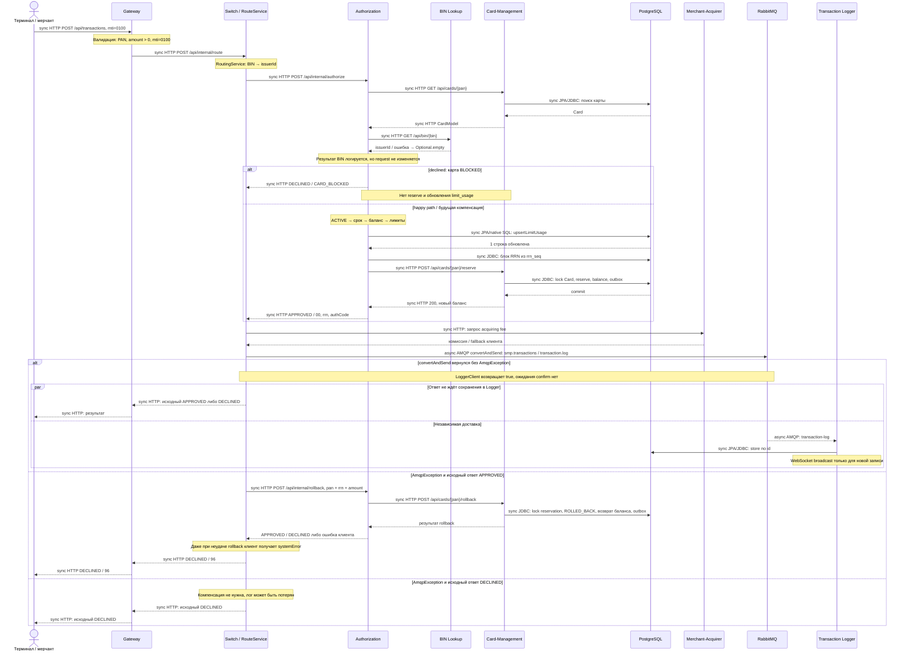

# А4. Sequence: happy path, declined, reversal

## Чего не хватало и что добавлено

Исходная sequence-диаграмма в `docs/architecture.md` описывает happy path. Здесь добавлены отказ по BLOCKED, компенсация после ошибки публикации, граница HTTP/AMQP и независимая обработка сообщения Logger. Диаграмма показывает **текущую реализацию**, а не желаемую гарантию доставки.

## Reversal 0400: требование и фактическая реализация

- В задании reversal обозначен как `mti=0400`. В текущем коде компенсация вызывается отдельным HTTP-запросом `POST /api/internal/rollback`; `RollbackRequest` содержит `rrn`, `pan`, `amount`, а не `mti`.
- В `AuthorizationRequest` есть helper `forReversal`, создающий `mti=0400`, но `RouteService` не использует его в рабочей ветке компенсации. Наличие helper не означает существование маршрута обработки reversal.
- Gateway принимает в транзакционном запросе **только `0100`**, поэтому рисовать работающий внешний маршрут `0400 → rollback` было бы неверно. `0400` остаётся пробелом реализации относительно задания.
- `publisher-confirm-type: correlated` включён, но `LoggerClient.log()` не создаёт `CorrelationData`, не ожидает подтверждения и не реализует дедлайн 2 секунды. Триггер показанной компенсации — синхронный `AmqpException`, **не** timeout подтверждения.
- После компенсации Switch не публикует отдельное событие `ROLLED_BACK`. `AuthServiceImpl.rollback()` также не уменьшает `limit_usage`. Нет распределённой транзакции между AUTH и CMS; отказ reserve после upsert требует отдельной проверки целостности.
- Публикация карточных outbox-событий планировщиком независима от HTTP-ответа. Её полная цепочка приведена в А2, А3 и А5.

## Подтверждение кодом

- [Gateway routes](../../../services/gateway/src/main/resources/application.yml), [TransactionRequestValidator.validate](../../../services/gateway/src/main/java/com/processing/gateway/validation/TransactionRequestValidator.java).
- [RouteService.route / buildTransaction](../../../services/switch/src/main/java/com/processing/service/RouteService.java), [AuthorizationClient.authorize / rollback](../../../services/switch/src/main/java/com/processing/service/AuthorizationClient.java), [AcquiringFeeClient](../../../services/switch/src/main/java/com/processing/service/AcquiringFeeClient.java).
- [AuthServiceImpl.authorize / rollback](../../../services/authorization/src/main/java/com/processing/authorization/services/AuthServiceImpl.java), [LimitUsageRepository.upsertLimitUsage](../../../services/authorization/src/main/java/com/processing/authorization/repositories/LimitUsageRepository.java).
- [CardServiceImpl.reserve / rollback](../../../services/card-management/src/main/java/com/processing/cardmanagement/services/CardServiceImpl.java), [Reservation](../../../services/card-management/src/main/java/com/processing/cardmanagement/models/Reservation.java).
- [LoggerClient.log](../../../services/switch/src/main/java/com/processing/service/LoggerClient.java), [Switch configuration](../../../services/switch/src/main/resources/application.yml), [RollbackRequest](../../../services/common/src/main/java/com/processing/common/dto/authorization/RollbackRequest.java).
- [TransactionLogListener](../../../services/transaction-logger/src/main/java/com/processing/transactionlogger/listener/TransactionLogListener.java), [TransactionService.store](../../../services/transaction-logger/src/main/java/com/processing/transactionlogger/service/TransactionService.java).
