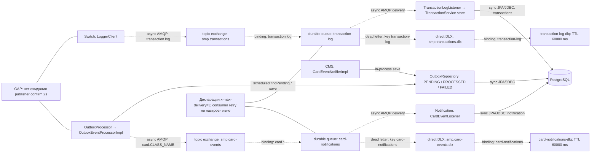

# А5. RabbitMQ: топология и гарантии доставки

## Чего не хватало и что добавлено

В исходной архитектуре есть текстовое описание очередей, но нет отдельной топологии. Добавлены две ветви exchange → queue → consumer, обе DLX/DLQ, точные routing keys и разделение деклараций конфигурации и реально реализованной обработки ошибок.

Сплошные стрелки — локальные вызовы / sync JDBC (подписаны отдельно); пунктирные — async AMQP или маршрутизация внутри брокера. Обе DLQ диагностические: TTL 60 секунд задан **на DLQ**, не как задержка retry. Обратной привязки DLQ → основная очередь в коде нет.

## Настройки и ограничения

| Механизм | Что подтверждается кодом | Чего нельзя считать гарантией |
|---|---|---|
| Publisher confirms Switch | `publisher-confirm-type: correlated`, `publisher-returns: true` | `convertAndSend` без исключения не проверяет ack; обработчик ack/nack и ожидание 2s в `LoggerClient` отсутствуют |
| Компенсация | `RouteService`: ошибка публикации + APPROVED → HTTP rollback → клиенту 96 | Поздний nack / потерянный confirm не являются реализованным триггером rollback |
| Consumer retry | На основных очередях объявлен `x-max-delivery=3` | В просмотренных конфигурациях Logger/Notification нет явного listener retry с тремя попытками; по одному аргументу нельзя обещать три обработки с последующим DLQ |
| DLX | Основные очереди задают dead-letter exchange и routing key; DLQ связаны с direct DLX | Само наличие DLX не доказывает, что любая ошибка consumer завершится reject без requeue |
| DLQ TTL | `.ttl(60_000)` на двух DLQ | Это время хранения недоставленных сообщений в DLQ, не TTL основной очереди и не retry interval |
| Outbox retry | `processSingleEvent` увеличивает `retryCount`, сохраняет ошибку, при `maxRetryCount` ставит FAILED; планировщик выбирает pending | По [CMS properties](../../../services/card-management/src/main/resources/application.properties) default max retry = 3, interval = 1000 ms; env может их изменить; это не retry consumer |
| Outbox success | После возврата `convertAndSend` событие становится PROCESSED | В процессоре нет ожидания broker confirm; PROCESSED не доказывает сохранение Notification |
| Logger idempotency | `TransactionService.store` сопоставляет повторный `id` с существующей записью; broadcast только новой записи | Это не exactly-once доставка и не дедупликация по одному STAN |
| Eventual consistency | Consumer сохраняет данные независимо от HTTP-ответа producer | Нельзя немедленно после 200/APPROVED требовать наличия записи; нужен ограниченный polling по корреляционному ключу |

Число попыток outbox, HTTP retry Authorization и consumer redelivery — **разные механизмы**. `switch.retry.max-attempts: 3` относится к HTTP-клиенту Authorization, не к Rabbit listener. Динамическая проверка брокера нужна отдельно; здесь проведён статический white-box анализ.

## Подтверждение кодом

- [Switch RabbitMQConfig](../../../services/switch/src/main/java/com/processing/config/RabbitMQConfig.java), [Logger RabbitMQConfig](../../../services/transaction-logger/src/main/java/com/processing/transactionlogger/config/RabbitMQConfig.java).
- [CMS RabbitMQConfig](../../../services/card-management/src/main/java/com/processing/cardmanagement/config/RabbitMQConfig.java), [Notification RabbitMQConfig](../../../services/notification-service/src/main/java/com/processing/notification/config/RabbitMQConfig.java).
- [LoggerClient](../../../services/switch/src/main/java/com/processing/service/LoggerClient.java), [Switch application.yml](../../../services/switch/src/main/resources/application.yml).
- [TransactionLogListener](../../../services/transaction-logger/src/main/java/com/processing/transactionlogger/listener/TransactionLogListener.java), [Logger application.yaml](../../../services/transaction-logger/src/main/resources/application.yaml).
- [CardEventNotifierImpl](../../../services/card-management/src/main/java/com/processing/cardmanagement/events/CardEventNotifierImpl.java), [OutboxProcessor](../../../services/card-management/src/main/java/com/processing/cardmanagement/services/OutboxProcessor.java), [OutboxEventProcessorImpl](../../../services/card-management/src/main/java/com/processing/cardmanagement/services/OutboxEventProcessorImpl.java), [CardOutboxEventData](../../../services/card-management/src/main/java/com/processing/cardmanagement/models/CardOutboxEventData.java).
- [CardEventListener](../../../services/notification-service/src/main/java/com/processing/notification/listener/CardEventListener.java), [Notification application.yml](../../../services/notification-service/src/main/resources/application.yml), [TransactionService](../../../services/transaction-logger/src/main/java/com/processing/transactionlogger/service/TransactionService.java).
