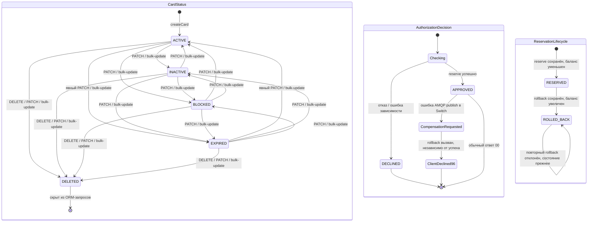

# А6. State-transition: Card, Transaction и Reservation

## Чего не хватало и что добавлено

State-диаграмм не было. Добавлены состояния карты, решения авторизации и **отдельный** жизненный цикл резерва. Существенная поправка к заданию: `ROLLED_BACK` существует в `ReservationStatus`, но не в `TransactionStatus`. Не изображаем отсутствующий переход строки Logger как работающий.

## Семантика и ограничения

| Объект | Реальные состояния и переходы | Важное ограничение |
|---|---|---|
| Card | ACTIVE, INACTIVE, BLOCKED, EXPIRED, DELETED | `withData` не задаёт специальную матрицу допустимых переходов; явное изменение между четырьмя неудалёнными статусами не запрещено этой моделью |
| Card expiry | Authorization отклоняет, если конец `expiryDate` раньше UTC-даты запроса | Автоматического присвоения Card.status=EXPIRED по наступлению даты в просмотренной логике нет; DECLINED/54 не доказывает смену статуса в БД |
| Deleted Card | `deleteCard` вызывает `deleted`, ORM скрывает DELETED | Обычным GET/PATCH через этот репозиторий удалённую карту уже не найти; удаление мягкое, не физическое |
| TransactionStatus | Только APPROVED и DECLINED | Нет enum ROLLED_BACK; нет записи такого события в `RouteService` после компенсации |
| AuthorizationDecision | Решение AUTH может быть APPROVED, но Switch после publish failure возвращает клиенту DECLINED/96 | Это два решения на разных границах, не UPDATE сохранённой транзакции в Logger |
| ReservationStatus | RESERVED → ROLLED_BACK | Повторный rollback вызывает `RollbackAlreadySatisfiedException`, баланс повторно не возвращается |

Переход CompensationRequested не гарантирует успех компенсации: `AuthorizationClient.rollback` может вернуть null/DECLINED. В этом случае ответ клиенту всё равно 96, а резерв может остаться RESERVED. Следовательно, `DECLINED/96` нельзя использовать как доказательство восстановления баланса.

`mti=0400` — обозначение reversal в задании. DTO имеет helper `forReversal`, но рабочая ветка `RouteService` использует `RollbackRequest` и отдельный `/rollback`, а Gateway принимает только `0100`; подробности в А4.

Три области на рисунке — независимые объекты/представления, а не один общий автомат. Для тестирования нужно отдельно наблюдать ответ клиента, состояние резерва и наличие строки Logger.

## Подтверждение кодом

- [CardStatus](../../../services/card-management/src/main/java/com/processing/cardmanagement/models/CardStatus.java), [Card.withData / deleted / checkStatusOrThrow](../../../services/card-management/src/main/java/com/processing/cardmanagement/models/Card.java), [CardServiceImpl](../../../services/card-management/src/main/java/com/processing/cardmanagement/services/CardServiceImpl.java).
- [CardEntity SQLRestriction](../../../services/card-management/src/main/java/com/processing/cardmanagement/models/CardEntity.java), [CardController](../../../services/card-management/src/main/java/com/processing/cardmanagement/controllers/CardController.java).
- [TransactionStatus](../../../services/common/src/main/java/com/processing/common/dto/transactionlogger/TransactionStatus.java), [RouteService](../../../services/switch/src/main/java/com/processing/service/RouteService.java), [AuthorizationClient.rollback](../../../services/switch/src/main/java/com/processing/service/AuthorizationClient.java).
- [ReservationStatus](../../../services/card-management/src/main/java/com/processing/cardmanagement/models/ReservationStatus.java), [Reservation.startRollback / rolledBack](../../../services/card-management/src/main/java/com/processing/cardmanagement/models/Reservation.java), [AuthServiceImpl](../../../services/authorization/src/main/java/com/processing/authorization/services/AuthServiceImpl.java).
- [AuthorizationRequest.forReversal](../../../services/common/src/main/java/com/processing/common/dto/authorization/AuthorizationRequest.java), [TransactionRequestValidator](../../../services/gateway/src/main/java/com/processing/gateway/validation/TransactionRequestValidator.java).
